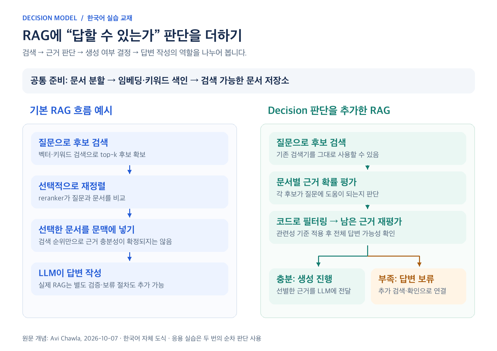

# Unsloth Decision 모델 만들기

한국어로 배우는 Decision 모델 교육 저장소입니다. 개념, PC 환경별 준비, 내 데이터로 학습하기, 모델 저장과 평가, RAG의 근거 판단까지 다룹니다. 모든 교재와 진행 대본은 Markdown이며 실습 코드는 Python입니다.

원문: [Train your own Decision Model with Unsloth](https://unsloth.ai/docs/basics/train-your-own-decision-model-with-unsloth) · 자료 기준일: **2026-10-11**

## 그림으로 보는 RAG 응용



[Avi Chawla의 X 글](https://x.com/_avichawla/status/2107767245917368751)을 바탕으로 RAG 응용 2개 장과 한국어 도식 4장을 추가했습니다. 그림의 역할 구분, 한국어 예제, 두 단계 판단 실습은 이 교재에 맞게 구성했습니다.

- [15장: RAG에 Decision 모델 연결](docs/15-rag-decision-gates.md): 검색 순위·관련성·답변 가능성 구분.
- [16장: 내 PC 실습](docs/16-rag-practice.md): GPU 없는 모의 실행과 로컬 Unsloth API 판단.
- [그림 모음과 편집 원본](assets/README.md): PNG 4장과 SVG 4개.

## 먼저 읽을 자료

- 처음 배우는 분: [01. 시작하기](docs/01-introduction.md)부터 순서대로 읽습니다.
- 바로 실행할 분: [실습 시작 안내](practice/README.md)에서 데이터 점검과 환경 준비를 진행합니다.
- 수업 진행자: [60분 강의 대본·추가 30분 실습·선택 RAG 20분](docs/teaching-script.md)을 사용합니다.
- Git으로 수정 이력을 남길 분: [Git 사용 안내](docs/git-workflow.md)를 봅니다.

## 내 PC에 맞는 길

이미 학습된 Laya를 실행하는 것과 내 정답 데이터로 모델을 학습하는 것은 서로 다른 단계입니다.

| PC 유형 | 먼저 체험하기 | 내 데이터로 학습하기 |
| --- | --- | --- |
| Windows + NVIDIA | Desktop/Studio에서 Laya 실행 | CUDA 환경의 Studio 또는 Python |
| Linux + NVIDIA | Desktop/Studio에서 Laya 실행 | CUDA 환경의 Studio 또는 Python |
| Apple Silicon Mac | Desktop에서 Laya 실행 | 최신 MLX Decision 학습 환경 |
| Intel Mac | CPU로 Laya 실행 | Colab GPU부터 권장 |
| GPU 없는 Windows/Linux | CPU로 Laya 실행 | Colab GPU부터 권장 |
| AMD GPU | 공식 AMD 설치 안내 확인 | 지원 조합을 Studio에서 소량 검증 |
| Intel GPU | 공식 Intel 설치 안내 확인 | 지원 조합을 Studio에서 소량 검증 |

자세한 조건은 [PC별 경로](docs/05-pc-environments.md), [설치 방법](docs/06-installation.md), [환경 확인 명령](practice/README.md)에 있습니다. 동봉 Python 학습 코드는 NVIDIA CUDA와 Apple Silicon MLX를 대상으로 합니다.

## 교재 목차

| 장 | 내용 |
| --- | --- |
| 01 | [시작하기](docs/01-introduction.md) |
| 02 | [Decision 모델의 구조](docs/02-decision-model.md) |
| 03 | [확률과 확률 보정](docs/03-probability-calibration.md) |
| 04 | [원문 성능표와 학습 설정](docs/04-source-benchmarks.md) |
| 05 | [내 PC에 맞는 경로 선택](docs/05-pc-environments.md) |
| 06 | [설치와 첫 실행](docs/06-installation.md) |
| 07 | [학습 전에 내 PC에서 판단해 보기](docs/07-local-inference.md) |
| 08 | [내 데이터를 만드는 방법](docs/08-training-data.md) |
| 09 | [화면으로 나만의 모델 학습하기](docs/09-studio-training.md) |
| 10 | [Python 실습과 Colab 학습](docs/10-python-colab.md) |
| 11 | [저장한 모델 사용하기](docs/11-save-and-use.md) |
| 12 | [오류 해결과 성능 개선](docs/12-troubleshooting.md) |
| 13 | [완료 확인과 다음 계획](docs/13-completion-checklist.md) |
| 14 | [출처와 변경 확인](docs/14-sources.md) |
| 15 | [Decision 모델을 RAG에 연결하기](docs/15-rag-decision-gates.md) |
| 16 | [내 PC에서 RAG 판단 흐름 실습하기](docs/16-rag-practice.md) |

## 설치 없이 데이터부터 점검하기

Python이 설치된 상태에서 저장소 폴더를 터미널로 엽니다. Mac/Linux에서는 환경에 따라 `python` 대신 `python3`를 사용하세요.

```bash
cd practice
python train_decision.py --check-data
```

이 단계는 Python 표준 라이브러리만 사용하며 모델을 내려받거나 학습하지 않습니다. 제공 데이터는 가상 고객 문의 48건이며 학습 24건·보정 12건·시험 12건으로 나뉩니다. 한 문장마다 담당 팀, 환불 여부, 긴급도 세 질문이 있습니다.

Unsloth 환경 준비가 끝나면 같은 `practice` 폴더에서 진행합니다.

```bash
python train_decision.py --max-steps 5 --output outputs/smoke
python train_decision.py --epochs 2 --output outputs/course
python predict_saved.py outputs/course/adapter
```

두 학습은 각각 기반 모델에서 새로 시작합니다. 5 step은 작동 점검용입니다. 전체 설치 조건과 옵션은 [실습 시작 안내](practice/README.md)를 따르세요.

## GPU 없이 RAG 판단 흐름 체험

저장소 최상위에서 실행합니다. 기본값은 고정된 예시 확률을 사용하는 `mock` 모드입니다.

```bash
python practice/rag_gate_demo.py
python practice/rag_gate_demo.py --scenario missing
python -m unittest discover -s tests -v
```

실제 검색이나 답변 생성은 수행하지 않습니다. API 모드로 실제 모델 판단을 받는 방법과 검증 범위는 [16장](docs/16-rag-practice.md)을 따르세요.

## 폴더 구성

```text
DM_training/
├── README.md
├── .gitignore
├── .gitattributes
├── docs/
│   ├── 01-introduction.md ... 16-rag-practice.md
│   ├── teaching-script.md
│   └── git-workflow.md
├── assets/
│   ├── README.md
│   └── diagrams/  # 한국어 도식 PNG + SVG
├── tests/
│   └── test_rag_gate.py
└── practice/
    ├── README.md
    ├── train_decision.py
    ├── predict_saved.py
    ├── call_api.py
    ├── rag_gate_demo.py
    ├── prepare_data.py
    ├── request.json
    └── data/
        ├── train.jsonl
        ├── calibration.jsonl
        └── test.jsonl
```

## 확인 범위와 기록

자료 제작 과정에서 코드 문법, 예제 데이터 형식, 정답 변환 규칙, 잘못된 자료 거부, 모의 API 호출을 점검했습니다. Markdown 문서 연결과 데이터 점검을 통과했습니다. RAG 보강에서는 모의 시나리오, 두 단계 판단의 동작 검사, 그림의 한글 표시를 확인했습니다. 실제 모델 다운로드, CUDA/MLX 학습, 실제 Unsloth API 추론, 모든 OS에서의 설치 검증은 수행하지 않았습니다.

교재 성능표는 공식 문서의 보고값입니다. 동봉 소량 가상 데이터의 점수는 실무 정확도를 입증하지 않습니다. 학습할 때는 `metrics.json`과 `environment.txt`에 실제 환경과 결과를 남깁니다.

모델 가중치, 학습 출력, 가상환경, API 키 파일은 `.gitignore`로 제외합니다. 원문과 소프트웨어·모델·외부 데이터의 라이선스는 각 배포처를 확인하세요. 전체 근거는 [출처](docs/14-sources.md)에 있습니다.
