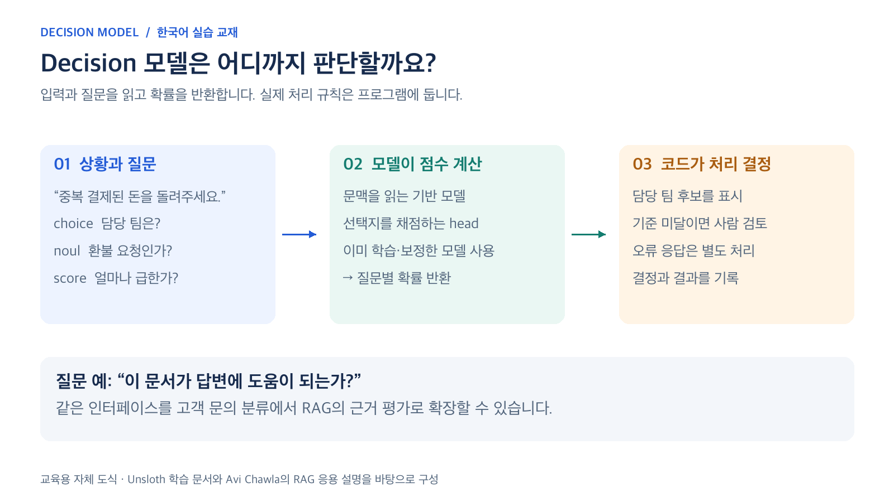

# 02. Decision 모델의 구조

고객이 “중복 결제된 금액을 오늘 돌려주세요”라고 썼다고 생각해 봅시다. 이 문장에서 담당 팀, 환불 요청 여부, 긴급도를 각각 묻습니다. 프로그램이 필요한 것은 미리 정한 값입니다. 예를 들어 billing, true, 2라는 답을 후속 처리에 사용할 수 있습니다.

| 방식 | 처리하는 방법 | 적합한 예 |
| --- | --- | --- |
| 규칙 | 정해진 문자열이나 조건 검사 | 고정 코드나 필수 필드 확인 |
| 일반 LLM 대화 | 다음 단어를 생성해 응답 작성 | 설명문, 요약문, 답변 초안 |
| Decision 모델 | 입력과 선택지를 비교해 점수 계산 | 담당 팀 배정, 태그, 단계 분류 |

*이 교재의 Unsloth 학습 경로를 설명한 자체 도식입니다. 모델과 실행 규칙의 역할을 구분합니다. [SVG 원본](../assets/diagrams/decision-workflow.svg)*

## 입력부터 결과까지

**문서와 질문과 선택지 → 언어 모델의 문맥 이해 → Decision head의 선택지 점수 → 확률 보정 → 프로그램의 처리 규칙**

언어 모델은 문장 의미를 읽는 몸체이고, head는 그 표현을 선택지별 숫자로 바꾸는 작은 모듈입니다. LoRA는 몸체 전체를 다시 학습하는 대신 작은 추가 가중치를 조정하는 방법입니다. 새 head도 함께 학습합니다. 4비트는 몸체 가중치의 메모리를 줄이는 설정이며, 전체 학습 메모리가 모델 파일 크기와 같아진다는 뜻은 아닙니다.

근거: [9. FastDecisionModel과 DecisionTrainer 구현](https://github.com/unslothai/unsloth/blob/main/unsloth/models/decision.py)

## 세 가지 질문 유형

| 유형 | 우리 예제 | 읽는 방법 |
| --- | --- | --- |
| choice | 담당 팀 한 곳 | billing 등 선택지 키와 각각의 확률 |
| noul | 환불 요청이 있는가 | 예라는 사건의 확률 또는 참거짓 답 |
| score | 긴급도 0부터 2 | 순서가 있는 단계와 단계별 확률 |

choice는 질문 하나에서 한 선택지를 고릅니다. 여러 태그를 동시에 붙이려면 태그마다 noul 질문을 만들 수 있습니다. score는 기준을 낮은 단계부터 순서대로 정의합니다. 고객의 말투가 강하다는 이유만으로 긴급이라고 정하면 정답 기준이 흔들립니다.

이름에 decision이 들어가지만 이 실습은 정답 예제를 사용하는 지도학습입니다. 보상을 주며 행동을 탐색하는 강화학습이나 업무 전체를 수행하는 에이전트와는 학습 목표가 다릅니다.

근거: [11. 정답과 확률 처리 구현](https://github.com/unslothai/unsloth/blob/main/unsloth/models/_decision_common.py)

## 고객 문의 분류에서 RAG 근거 평가로

같은 질문 형태를 문서 검색에도 적용할 수 있습니다. `state`에 사용자 질문과 검색 문서를 넣고, 문서마다 `noul`로 “답할 근거가 되는가?”를 묻습니다. 코드가 기준을 적용한 뒤 남은 근거를 다시 평가합니다. 전체 예제는 [15장](15-rag-decision-gates.md)에 있습니다.

Decision 모델을 만든다는 말은 여러 구현을 가리킬 수 있습니다. 이 교재의 Unsloth 경로는 head와 추가 가중치를 학습합니다. 반면 원문에 연결된 로컬 구현은 기존 LLM의 선택지 토큰 점수를 읽는 추론 방식입니다. 학습 여부와 보정 여부를 구분하는 비교는 [15장의 구현 방식 설명](15-rag-decision-gates.md)을 참고하세요.

---

[전체 목차](../README.md) · [이전 장](01-introduction.md) · [다음 장](03-probability-calibration.md)
