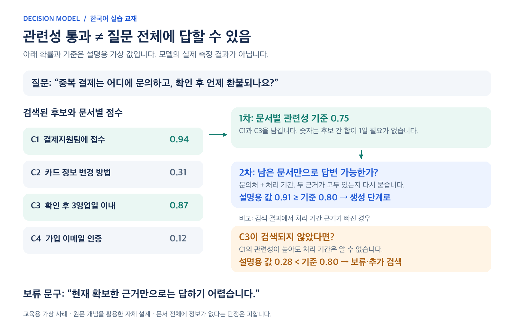

# 15. Decision 모델을 RAG에 연결하기

이 장은 사용자가 공유한 Avi Chawla의 [RAG vs. Jev + RAG 게시물](https://x.com/_avichawla/status/2107767245917368751)을 기존 Unsloth 실습에 연결합니다. 게시일은 2026-10-07이며 본문과 동적 도식을 확인했습니다. 아래 한국어 그림과 고객 문의 사례는 이 교재를 위해 새로 구성했습니다.

## 원문의 핵심을 쉽게 풀면

RAG는 질문과 관련된 자료를 검색하고, 그 자료를 언어 모델에 전달해 답을 쓰게 하는 방식입니다. 게시물은 **검색 순위가 높다는 것과 질문에 답할 근거가 충분하다는 것을 구분**합니다. Jev가 후보 문서의 유용성을 판단하고, 코드는 확률 기준에 따라 문서를 남기거나 답변을 보류합니다. 검색기와 답변을 쓰는 LLM은 계속 필요합니다. [원문](https://x.com/_avichawla/status/2107767245917368751)

*그림 1. 원문의 역할 분담을 한국어로 재구성한 교육용 도식입니다. 오른쪽의 순차 판단 방식은 이 교재의 구현 선택입니다. [수정 가능한 SVG](../assets/diagrams/rag-comparison.svg)*

실제 RAG 시스템에도 이미 답변 보류, 근거 검사, 재검색이 있을 수 있습니다. 그림 왼쪽은 설명용 기본 흐름입니다. Jev만이 이런 구조를 만들 수 있다거나 기존 reranker보다 언제나 우수하다는 뜻은 아닙니다.

## 검색, 재정렬, 필터링, 답변 가능성

| 단계 | 묻는 질문 | 우리 실습에서의 의미 |
| --- | --- | --- |
| 검색 retrieval | 어떤 문서가 후보인가? | 검색된 것으로 가정한 C1~C4를 입력 |
| 재정렬 reranking | 후보를 어떤 순서로 볼까? | 관련성 점수 순으로 정렬 |
| 필터링 filtering | 어떤 후보를 제외할까? | 관련성 기준에 미달하면 문맥에서 제외 |
| 답변 가능성 answerability | 남은 근거로 질문 전체에 답할 수 있나? | 문의처와 처리 기간이 모두 있는지 확인 |
| 생성 generation | 사용자에게 어떻게 설명할까? | 통과한 근거를 LLM에 전달하는 다음 단계 |

순위와 통과 기준은 역할이 다릅니다. 전부 무관한 후보라도 정렬하면 1등이 생깁니다. 반대로 두 문서가 각각 질문의 절반을 설명한다면 함께 사용해야 답이 완성됩니다. 작성자는 RAG 응용 글에서 개별 문서 평가와 전체 근거 평가를 나누어 설명합니다. [작성자의 상세 글](https://blog.dailydoseofds.com/p/jev-for-rag-clearly-explained)

## 한국어 예제: 문의처와 처리 기간을 함께 묻기

질문은 **“중복 결제는 어디에 문의하고, 확인 후 언제 환불되나요?”**입니다. 다음 문서, 확률, 기준은 모두 교육용 가상 사례입니다.

| 문서 | 내용 | 관련성 확률 예시 | 기준 0.75 적용 |
| --- | --- | --- | --- |
| C1 | 중복 결제는 결제지원팀에 접수합니다. | 0.94 | 남김 |
| C2 | 카드 정보는 마이페이지에서 변경합니다. | 0.31 | 제외 |
| C3 | 중복 결제가 확인되면 3영업일 이내에 환불합니다. | 0.87 | 남김 |
| C4 | 가입할 때 이메일 인증이 필요합니다. | 0.12 | 제외 |

각 문서에 독립적인 `noul` 질문을 붙입니다. “C1이 도움이 되는가?”와 “C3이 도움이 되는가?”는 동시에 참일 수 있습니다. 따라서 이 네 확률의 합을 1로 맞출 필요가 없습니다. 한 문서만 골라야 하는 `choice`와 목적이 다릅니다.

*그림 2. 관련성은 통과했지만 전체 질문에는 답하지 못하는 경우를 비교합니다. 숫자는 실제 추론 결과가 아닙니다. [수정 가능한 SVG](../assets/diagrams/two-stage-gate.svg)*

C1은 문의처, C3은 처리 기간의 근거입니다. 둘을 남긴 뒤 답변 가능성을 0.91로 판단했다면 예시 기준 0.80을 통과합니다. 반면 C3이 검색되지 않았으면 C1의 점수가 높아도 처리 기간을 알 수 없습니다. 실습의 모의 값 0.28에서는 답변을 보류합니다.

## 왜 이 실습은 판단을 두 번 호출하나?

원문은 문서별 질문과 답변 가능성 질문을 한 요청에 넣는 구성을 설명합니다. 다만 프로그램이 **첫 응답을 받은 뒤** 임계값으로 문서를 제거한다면, 첫 요청을 보낼 때는 실제 남을 문서 집합이 아직 확정되지 않습니다.

이 교재는 그 의존성을 명확히 하기 위해 다음처럼 구현합니다.

1. 첫 요청: 검색된 각 문서가 질문에 도움이 되는지 판단합니다.
2. 프로그램: 관련성 기준을 적용해 문서 집합을 확정합니다.
3. 두 번째 요청: **확정된 문서만** 넣고 질문 전체에 답할 수 있는지 판단합니다.
4. 프로그램: 답변 가능성 기준을 통과하면 생성용 문맥을 준비합니다.

여러 개의 독립 질문을 묶어 보내는 것과 앞선 답에 의존하는 질문을 같은 호출에 넣는 것은 구분해야 합니다. 두 번의 호출은 추가 지연을 만들므로 운영 환경에서는 정확도와 시간을 함께 비교합니다. 이는 원문의 벤치마크 결과가 아니라 교재의 설계 판단입니다.

검색 후보가 없거나 필터링 후 하나도 남지 않으면 두 번째 판단을 호출하지 않습니다. API 오류나 필수 필드 누락은 “근거 부족” 판정과 별도로 처리합니다.

## Unsloth, Laya, Jev, SGLang은 어떻게 연결되나?

| 이름 또는 방식 | 이 자료에서의 역할 | 구분할 점 |
| --- | --- | --- |
| Jev | X 게시물에서 근거 판단에 사용한 모델 | 해당 제품의 모델·성능과 우리 로컬 예제는 별개 |
| Laya + Unsloth API | 이미 학습된 로컬 모델로 같은 종류의 질문 체험 | 별도 학습 없이 먼저 평가 가능 |
| Unsloth 추가 학습 | 내 라벨 자료로 기반 모델과 Decision head 조정 | 기존 교재의 8~11장 경로 |
| SGLang 선택지 채점 | 기존 언어 모델의 지정 토큰 점수를 읽는 추론 방식 | 점수를 얻는 것만으로 학습·보정이 재현되지는 않음 |

Unsloth는 로컬 Laya를 TypeSafe 호환 Decision API로 제공한다고 설명합니다. API 모양이 호환되어도 서로 다른 모델의 확률이나 `confidence` 값을 동일하게 취급해서는 안 됩니다. [Unsloth 로컬 API 안내](https://unsloth.ai/docs/models/decision-laya)

게시물에 연결된 [Build your own Jev](https://x.com/_avichawla/article/2101563610644496464)는 추가 학습 없이, 허용된 답에 대응하는 다음 토큰 점수를 읽는 예를 설명합니다. 저자도 이것이 Jev 전체 시스템의 재현은 아니라고 구분합니다.

예를 들어 A·B·C를 선택지에 대응시켜 해당 토큰의 logit만 정규화할 수 있습니다. 이때 확률은 지정한 선택지 안에서의 상대값입니다. 답이 없는 입력에도 누군가는 가장 높은 값을 받으므로 `other` 같은 탈출 선택지와 별도 평가가 필요합니다. SGLang의 `/v1/score`는 지정한 `label_token_ids`에 대한 점수를 반환하며, 모델마다 토큰화와 레이블 순서를 확인해야 합니다. [SGLang 공식 API](https://docs.sglang.io/docs/basic_usage/native_api), [LMSYS의 기술 설명](https://www.lmsys.org/blog/2026-09-25-sglang-decision-models/)

입문 순서는 **Laya로 판단 체험 → 내 업무 자료로 평가 → 필요하면 추가 학습**으로 잡을 수 있습니다. SGLang은 별도 서버·모델 지원 조건이 있는 선택 경로이며, 모든 PC용 공통 설치 절차는 아닙니다.

## 업무용 RAG로 확장할 때 달라지는 데이터

기존 고객 문의 실습의 정답은 담당 팀·환불 여부·긴급도입니다. RAG 판정에 맞추려면 다음 두 종류의 정답을 새로 모읍니다.

| 데이터 단위 | 정답 질문 | 함께 넣을 어려운 사례 |
| --- | --- | --- |
| 사용자 질문 + 문서 한 개 | 질문 일부에 직접적인 근거가 되는가? | 같은 단어만 포함한 문서, 대상 상품·버전이 다른 문서 |
| 사용자 질문 + 선별 문서 묶음 | 질문의 모든 부분을 뒷받침하는가? | 일부 근거 누락, 날짜 충돌, 서로 모순되는 정책 |

한 질문에서 나온 문서 쌍을 행 단위로 무작위 분리하면 거의 같은 질문이 학습과 시험에 섞일 수 있습니다. 질문·원문 문서·관련 대화의 묶음과 시점을 고려해 분리합니다. 고객 문의 48건만 학습했다고 RAG 근거 평가 능력을 검증한 것이 되지는 않습니다.

## 무엇을 측정해야 할까?

먼저 같은 질문 묶음으로 기존 RAG와 판단 단계를 추가한 RAG를 비교합니다. 아래는 자체 실험 설계 제안입니다.

| 지표 | 확인하는 실패 |
| --- | --- |
| 검색 후보에 정답 근거가 포함된 비율 | 검색 단계에서 이미 필요한 문서를 놓침 |
| 필터 통과 문서의 근거 적합성 | 무관한 자료를 생성 문맥에 넣음 |
| 필터가 보존한 정답 근거 비율 | 지나치게 높은 기준으로 필요한 자료를 버림 |
| 답변 가능성 판단의 오통과·오보류 | 근거가 부족한데 생성하거나, 충분한데 막음 |
| 최종 답변의 근거 일치·질문 충족 | 통과한 문맥을 받아도 생성기가 내용을 틀림 |
| 보류율, 지연 시간, 호출 수 | 품질 개선에 필요한 운영 비용 |

확률 보정은 [3장](03-probability-calibration.md)처럼 별도 자료로 확인합니다. 관련성 기준과 답변 가능성 기준은 다른 질문에 대한 값이므로 각각 조절합니다. 최종 시험 자료는 기준 선택에 사용하지 않습니다.

## 보류할 때의 표현

이 교재의 보류 문구는 **“현재 확보한 근거만으로는 답하기 어렵습니다.”**입니다. 후보 안에서 근거를 찾지 못했어도 문서 저장소 전체에 정보가 없다고 단정할 수는 없습니다. 추가 검색, 질문 구체화, 담당자 확인으로 이어갈 수 있습니다.

판단 모델도 잘못된 확률을 낼 수 있고, 생성 모델도 전달받은 근거를 잘못 사용할 수 있습니다. 문서에 들어 있는 지시문을 판정 기준으로 삼지 않고, 실제 실행 권한이나 보안 규칙은 별도로 관리합니다. 관련 내용은 [작성자의 Jev 설명](https://blog.dailydoseofds.com/p/jev-clearly-explained)에 함께 제시되어 있습니다.

---

[전체 목차](../README.md) · [이전 장](14-sources.md) · [다음 장: PC 실습](16-rag-practice.md)
