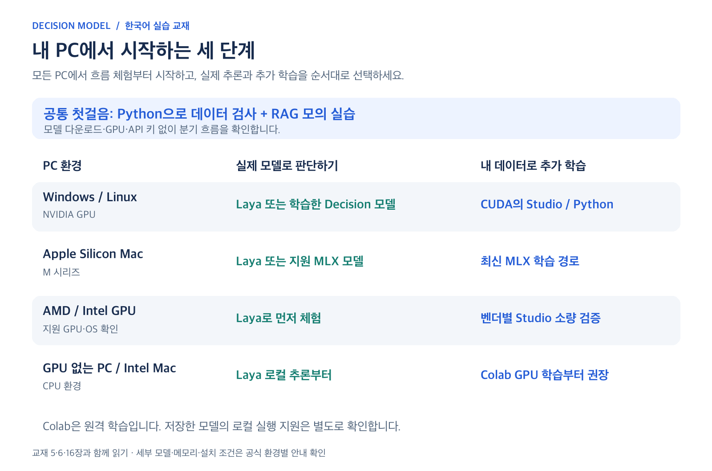

# 16. 내 PC에서 RAG 판단 흐름 실습하기

이 장은 [15장](15-rag-decision-gates.md)의 두 단계 판단을 실행합니다. 모의 실습은 Python 표준 라이브러리만 사용하며 Windows, macOS, Linux에서 같은 명령을 사용할 수 있습니다. Mac/Linux에서는 환경에 따라 `python` 대신 `python3`를 사용합니다.



*그림 3. 흐름 체험·모델 실행·추가 학습을 구분한 안내입니다. [수정 가능한 SVG](../assets/diagrams/pc-learning-paths.svg)*

## 실습 범위

[rag_gate_demo.py](../practice/rag_gate_demo.py)는 검색 결과를 가정한 문서 네 개를 입력받아 필터링과 답변 가능성을 확인합니다. 실제 검색기와 답변 생성기는 포함하지 않습니다.

| 모드 | 하는 일 | 필요한 환경 |
| --- | --- | --- |
| `mock` | 정해 둔 가상 확률로 처리 순서 체험 | Python만 필요 |
| `api` | 로컬 Unsloth Decision API에 실제 판단 요청 | Laya 등 모델을 실행 중인 Desktop/Studio |

두 모드 모두 생성 모델을 호출하지 않습니다. 성공 결과인 `ready_for_generation`은 생성용 근거가 준비되었다는 뜻입니다. 실제 답변 생성 성공을 뜻하지 않습니다.

## 1. 모델 없이 5분 체험

저장소 최상위에서 `practice`로 이동합니다.

```bash
cd practice
python rag_gate_demo.py
```

기본값은 `--mode mock --scenario complete`입니다. 출력에는 다음 항목이 들어갑니다.

```json
{
  "kept_ids": ["C1", "C3"],
  "answerability": 0.91,
  "decision": "ready_for_generation",
  "generation_called": false,
  "mode": "mock",
  "scores_are_simulated": true
}
```

이는 전체 출력의 일부이며 고정된 교재용 모의 결과입니다. `mock_judge`는 문장 의미를 이해하지 않고 예제 ID에 맞는 값을 반환합니다. 다른 업무 문장을 넣어 품질을 시험하는 모델로 사용할 수 없습니다.

## 2. 근거가 빠진 경우 비교

```bash
python rag_gate_demo.py --scenario missing
python rag_gate_demo.py --scenario empty
```

| 조건 | 예상 모의 결과 | 배울 점 |
| --- | --- | --- |
| `complete` | C1·C3 남김, 0.91, 생성 준비 | 문의처와 처리 기간이 모두 있음 |
| `missing` | C1만 남김, 0.28, 보류 | 관련 문서 하나로 전체 질문을 해결하지 못함 |
| `empty` | 남은 문서 없음, 답변 가능성 값 없음, 보류 | 검색 결과가 없으면 모델 호출도 생략 |

`missing`은 검색 결과에 처리 기간 문서 C3이 들어오지 않은 상황입니다. 검색기가 놓친 문서를 판단 모델이 복원해 주지는 못합니다. `empty`에서 답변 가능성의 `null`은 0점이 아니라 **판단하지 않음**을 뜻합니다.

## 3. 기준을 바꾸면 어떻게 달라질까?

```bash
python rag_gate_demo.py --relevance-threshold 0.90
python rag_gate_demo.py --relevance-threshold 0.99
python rag_gate_demo.py --answerability-threshold 0.95
```

첫 명령은 0.87인 C3을 제거해 답변에 필요한 기간 근거를 잃습니다. 두 번째는 모든 문서를 제거하므로 두 번째 판단을 생략합니다. 세 번째는 문서가 충분한 모의 상황에서도 0.91이 새 기준에 못 미쳐 보류합니다.

기준을 높이면 항상 좋은 결과가 되는 것은 아닙니다. 실제 업무에서는 검증 자료로 오통과와 오보류를 함께 측정하세요. 0.75와 0.80은 이 교재의 설명용 값입니다.

## 4. 실제 로컬 모델로 판단

먼저 [기존 API 실습](../practice/README.md)의 설치와 실행 준비를 마칩니다.

1. Desktop/Studio에서 Settings → API → Decision API를 엽니다.
2. `Serve requests`를 켜고 한국어용 multilingual Laya를 준비합니다.
3. 필요하면 현재 터미널에 API 키를 설정합니다.
4. 같은 `practice` 폴더에서 API 모드로 실행합니다.

macOS/Linux:

```bash
export UNSLOTH_API_KEY="여기에_내_API_키"
python3 rag_gate_demo.py --mode api
```

Windows PowerShell:

```powershell
$env:UNSLOTH_API_KEY="여기에_내_API_키"
python rag_gate_demo.py --mode api
```

앱 포트가 다르면 `--port 실제포트`를 추가합니다. `--model default`는 앱에서 선택한 Decision 모델입니다. 응답의 `answers[질문이름].noul`을 읽습니다. 이 형식은 [Unsloth 공식 API 예제](https://unsloth.ai/docs/models/decision-laya)를 따릅니다.

API 모드의 실제 값은 모의 값과 다를 수 있습니다. 코드가 모델을 학습하거나 모의 점수를 실제 결과로 보정하지 않습니다. 출력의 `scores_are_simulated`는 `false`가 됩니다.

실습 입력은 짧게 유지합니다. Laya multilingual의 문서상 문맥 한도는 1024 토큰이며, 질문과 자료를 함께 넣을 공간이 필요합니다. 후보 개수만 보고 길이를 판단하지 마세요. 이 코드는 실제 모델의 토큰 잘림을 자동 검증하지 않으므로 긴 문서로 확장할 때 별도 확인이 필요합니다. [Unsloth 모델 조건](https://unsloth.ai/docs/models/decision-laya)

## 5. 코드에서 확인할 부분

| 함수 | 읽을 내용 |
| --- | --- |
| `run_pipeline` | 문서별 판단 → 필터 → 남은 문서 재판단의 순서 |
| `state_for` | 사용자 질문과 현재 문서 집합을 요청에 넣는 방법 |
| `read_noul` | 누락·문자열·범위 밖 확률을 정상 응답으로 처리하지 않음 |
| `mock_judge` | 수업용 가상 값; 실제 의미 판정 기능은 없음 |
| `local_judge` | `127.0.0.1`의 Decision API에만 요청 |

현재 질문은 문의처와 처리 기간을 함께 묻습니다. 다른 업무로 바꾸려면 `QUERY`, `CANDIDATES`와 답변 가능성의 판단 기준을 함께 수정합니다. `mock_judge`의 ID 규칙은 해당 예제 전용이므로 실제 품질 평가는 API 모드와 사람의 정답을 사용합니다.

통과한 문서 목록은 `context_for_generator`에 들어갑니다. 실제 RAG와 연결할 때는 이 문맥을 생성기에 전달하고, 근거 인용과 최종 답변의 정확성까지 추가로 평가합니다. 보류하거나 오류가 난 요청에서는 생성기를 호출하지 않도록 연결하세요.

## 6. 검증과 수업 기록

저장소 최상위에서 실행합니다.

```bash
python -m unittest discover -s tests -v
```

검사는 근거 누락 시 보류, 필터 후 문서만 두 번째 요청에 포함, 빈 결과의 호출 생략, 잘못된 확률 거부 등을 확인합니다. 네트워크나 GPU를 사용하지 않습니다.

이 자료를 보강하면서 모의 실행과 위 동작 검사를 수행했습니다. 실제 Unsloth 모델의 RAG 판단 품질, GPU 학습, 전체 검색·생성 파이프라인은 이번 작업에서 실행하지 않았습니다.

기록할 항목은 질문, 검색 후보, 남긴 문서, 두 기준값, 실제 확률, 판단 시간, 생성 여부, 사람이 확인한 정답입니다. 모의 실습 기록에는 반드시 `mock`이라고 적습니다.

---

[전체 목차](../README.md) · [이전 장](15-rag-decision-gates.md) · [강의 진행 대본](teaching-script.md)
